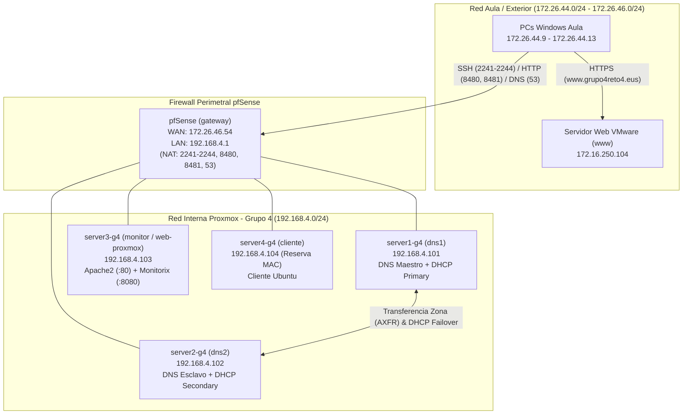

# Reto 4 — Grupo 4 (`grupo4reto4.eus`)

Documentación técnica del despliegue de infraestructura, seguridad perimetral y servicios en red sobre Proxmox VE, pfSense y Ubuntu Server.

---

## Índice de Documentación

* **[Fase 0: Preparación Inicial y Acceso Remoto (SSH)](informe/fase0.md)**
  * Configuración de red estática, nombres de equipo (`hostnames`) y zona horaria.
  * Despliegue de servidor SSH, generación de claves `ed25519` y acceso remoto mediante clave pública.
* **[Fase 1: Cortafuegos Perimetral pfSense y Reglas NAT](informe/fase1.md)**
  * Desactivación del servidor DHCP integrado en pfSense.
  * Configuración de reglas de redirección de puertos (`Port Forwarding`) restringidas a la red del aula (`172.26.44.0/24`).
* **[Fase 2: Servicio DHCP en Alta Disponibilidad (Failover)](informe/fase2.md)**
  * Configuración de `isc-dhcp-server` en modo `primary` (`server1-g4`) y `secondary` (`server2-g4`).
  * Reparto dinámico, reserva de IP por dirección MAC (`server4-g4`) y pruebas de tolerancia a fallos.
* **[Fase 3: Servicio DNS Maestro-Esclavo (`grupo4reto4.eus`)](informe/fase3.md)**
  * Configuración de BIND9 en maestro (`server1-g4`) y esclavo (`server2-g4`) con zonas directa e inversa.
  * Sincronización mediante actualización de Serial, alias (`CNAME`), consultas desde la WAN y pruebas de caída.
* **[Fase 4: Servidor Web Apache2 y Monitorización con Monitorix](informe/fase4.md)**
  * Configuración de VirtualHost en Apache2 (`server3-g4`) con registros personalizados y acceso externo.
  * Despliegue de Monitorix, integración de gráficas de Apache y acceso remoto.

---

## Diagrama de Topología de Red

---

## Tabla de Direccionamiento IP y Servicios

### 1. Subredes, Equipos y Alias DNS

| Equipo / Hostname | Alias DNS (`CNAME`) | Red / Interfaz | Dirección IP | Rol y Servicios |
| :--- | :--- | :--- | :--- | :--- |
| **pfSense (`gateway`)** | `pfsense` | WAN / LAN | `172.26.46.54` / `192.168.4.1` | Firewall perimetral, NAT y enrutamiento |
| **`server1-g4`** | `dns1` | LAN (`192.168.4.0/24`) | `192.168.4.101` | DNS Maestro (BIND9), DHCP Primario (Failover) |
| **`server2-g4`** | `dns2` | LAN (`192.168.4.0/24`) | `192.168.4.102` | DNS Esclavo (BIND9), DHCP Secundario (Failover) |
| **`server3-g4`** | `monitor`, `web-proxmox` | LAN (`192.168.4.0/24`) | `192.168.4.103` | Servidor Web Apache2 (`:80`), Monitorix (`:8080`) |
| **`server4-g4`** | `cliente` | LAN (`192.168.4.0/24`) | `192.168.4.104` *(Reserva MAC)* | Cliente Ubuntu (`bc:24:11:dc:86:25`) |
| **Pool Dinámico DHCP** | — | LAN (`192.168.4.0/24`) | `192.168.4.150` – `.199` | Rango dinámico gestionado en alta disponibilidad |
| **`web-vmware`** | `www`, `web-server`, `@` | Red VMware | `172.16.250.104` | Servidor Web principal del grupo |
| **`web-interna`** | — | Red Interna | `10.0.4.2` | Servicio web interno |
| **`pc-win1` .. `pc-win5`** | — | Red Aula (`172.26.44.0/24`) | `172.26.44.9` – `.13` | Equipos físicos de administración y pruebas |

### 2. Reglas de Redirección de Puertos (NAT Port Forward en `172.26.46.54`)

| Servicio | Protocolo | Origen Permitido | Puerto Externo (WAN) | IP Interna Destino | Puerto Interno |
| :--- | :--- | :--- | :--- | :--- | :--- |
| **SSH `server1-g4`** | TCP | `172.26.44.0/24` | `2241` | `192.168.4.101` | `22` |
| **SSH `server2-g4`** | TCP | `172.26.44.0/24` | `2242` | `192.168.4.102` | `22` |
| **SSH `server3-g4`** | TCP | `172.26.44.0/24` | `2243` | `192.168.4.103` | `22` |
| **SSH `server4-g4`** | TCP | `172.26.44.0/24` | `2244` | `192.168.4.104` | `22` |
| **Web Apache2** | TCP | `172.26.44.0/24` | `8480` | `192.168.4.103` | `80` |
| **Monitorix** | TCP | `172.26.44.0/24` | `8481` | `192.168.4.103` | `8080` |
| **DNS (`grupo4reto4.eus`)** | TCP/UDP | `172.26.44.0/24` | `53` | `192.168.4.101` | `53` |
