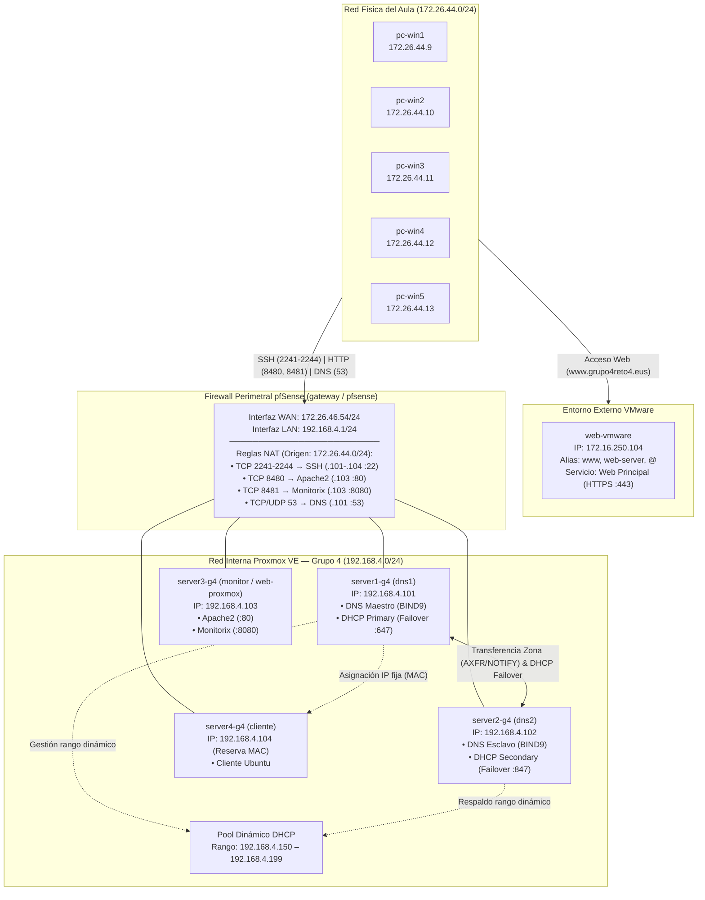

# Mapa Lógico de la Red — Grupo 4 (`grupo4reto4.eus`)

[⬅ Volver al índice principal](../README.md)

## Resumen de Flujos Lógicos

* **Desde el Aula (`172.26.44.0/24`):** Los 5 equipos Windows (`pc-win1` a `pc-win5`) tienen acceso filtrado por el cortafuegos `pfSense` (`172.26.46.54`) hacia los puertos redirigidos por NAT (`2241–2244` para administración SSH, `8480` para Apache2, `8481` para Monitorix y `53` para resolución DNS), además de acceso directo al servidor web del grupo en VMware (`172.16.250.104`).
* **En la Red Interna Proxmox (`192.168.4.0/24`):** `pfSense` (`192.168.4.1`) actúa como puerta de enlace con su servicio DHCP deshabilitado. La asignación de direcciones IP recae sobre el clúster `isc-dhcp-server` en alta disponibilidad entre `server1-g4` (`.101`) y `server2-g4` (`.102`), que también operan como servidores DNS maestro y esclavo autoritativos para el dominio `grupo4reto4.eus`.
