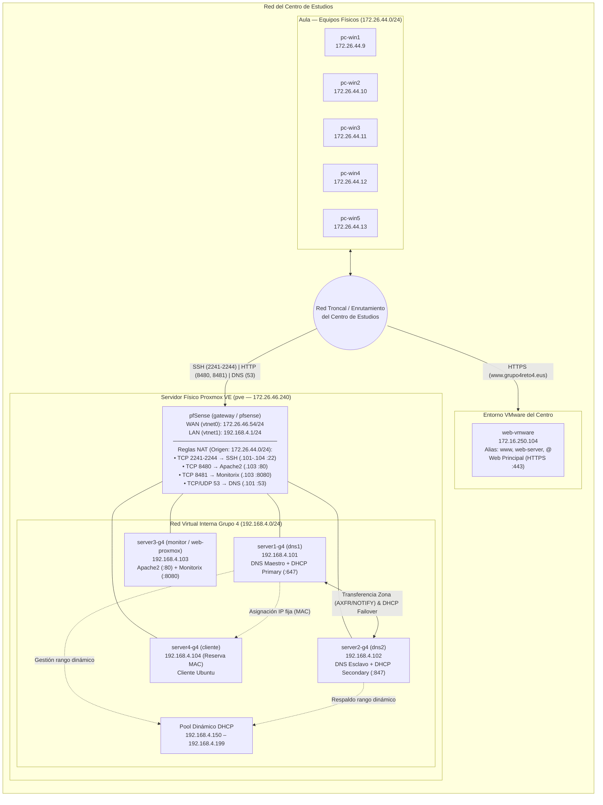

# Mapa Lógico de la Red — Grupo 4 (`grupo4reto4.eus`)

[⬅ Volver al índice principal](../README.md)

## Descripción de la Topología Lógica

* **Subred del Aula (`172.26.44.0/24`):** Alberga los 5 equipos físicos Windows (`pc-win1` a `pc-win5`, IPs `.9` a `.13`) desde los que se administra la infraestructura y se validan los servicios[cite: 1].
* **Red Troncal del Centro:** Interconecta la subred del aula con las redes donde se alojan los hipervisores del centro (`172.26.46.0/24` para Proxmox VE y `172.16.250.0/24` para VMware)[cite: 1, 4].
* **Servidor Proxmox VE (`172.26.46.240`) y Red Interna (`192.168.4.0/24`):** El nodo Proxmox aloja tanto la máquina virtual de **pfSense** (con interfaz WAN `vtnet0` en `172.26.46.54/24` e interfaz LAN `vtnet1` en `192.168.4.1/24`) como los cuatro servidores Ubuntu del Grupo 4 (`server1-g4` a `server4-g4`), aislados tras el cortafuegos[cite: 1, 4].
