# Memoria Técnica — Reto 4 (Grupo 4)

[⬅ Volver al índice principal](../README.md)

---

## Fase 0: Preparación Inicial y Acceso Remoto (SSH)

### 0.1. Configuración de Red, Hostnames y Zona Horaria

* Configuramos el direccionamiento IP estático en los servidores de la red interna (`192.168.4.0/24`) con puerta de enlace `192.168.4.1`.
  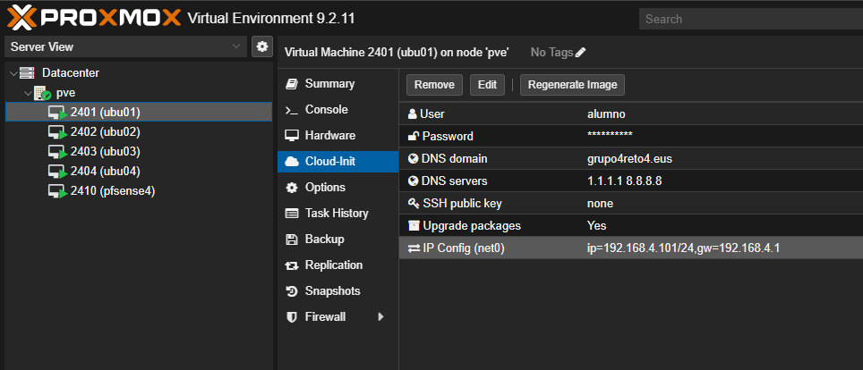
  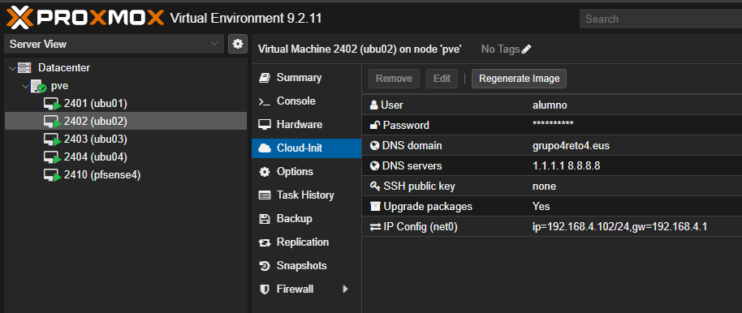
  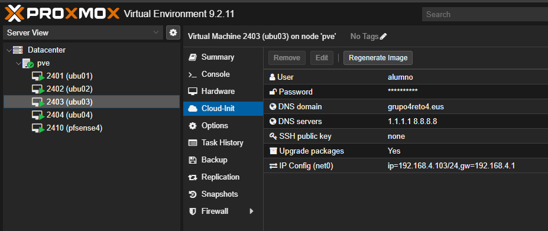
  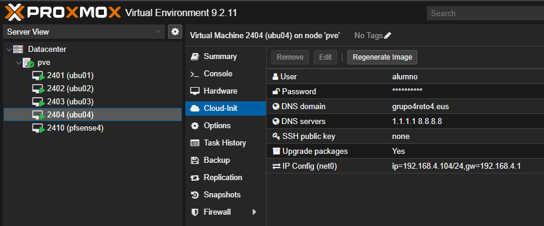
  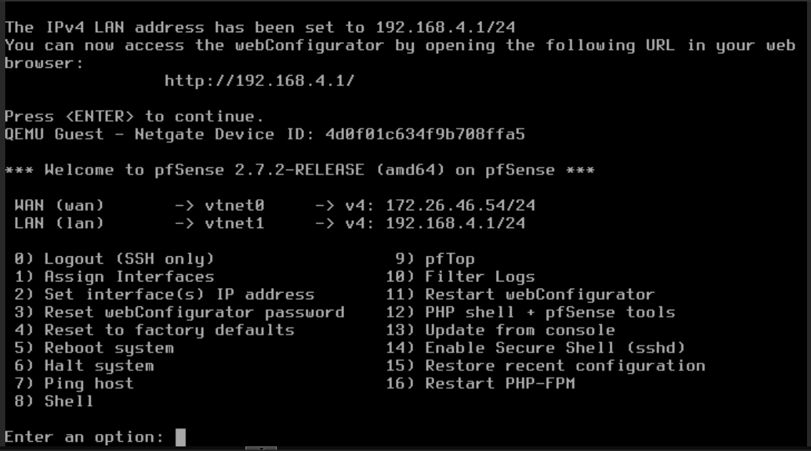
* Asignamos los nombres de equipo (`server1-g4`, `server2-g4`, `server3-g4`, `server4-g4`) para identificar cada nodo de la infraestructura.
  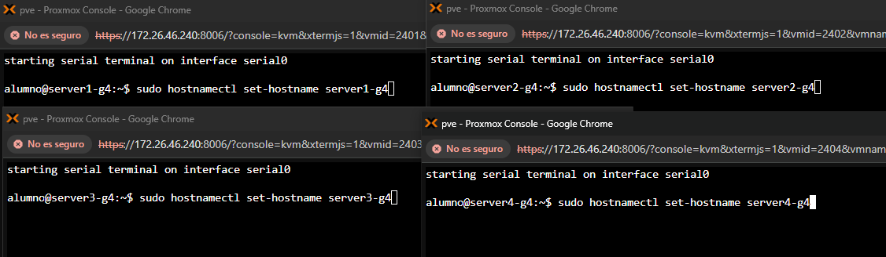
* Ajustamos la zona horaria (`Europe/Madrid`) en todos los servidores para sincronizar los registros y marcas de tiempo de los servicios.
  
  
  
  

### 0.2. Servicio SSH y Autenticación por Clave Pública

* Instalamos `openssh-server`, editamos `/etc/ssh/sshd_config` para habilitar `PubkeyAuthentication yes` y `PasswordAuthentication yes`, y reiniciamos el servicio (`sudo systemctl restart ssh`).
  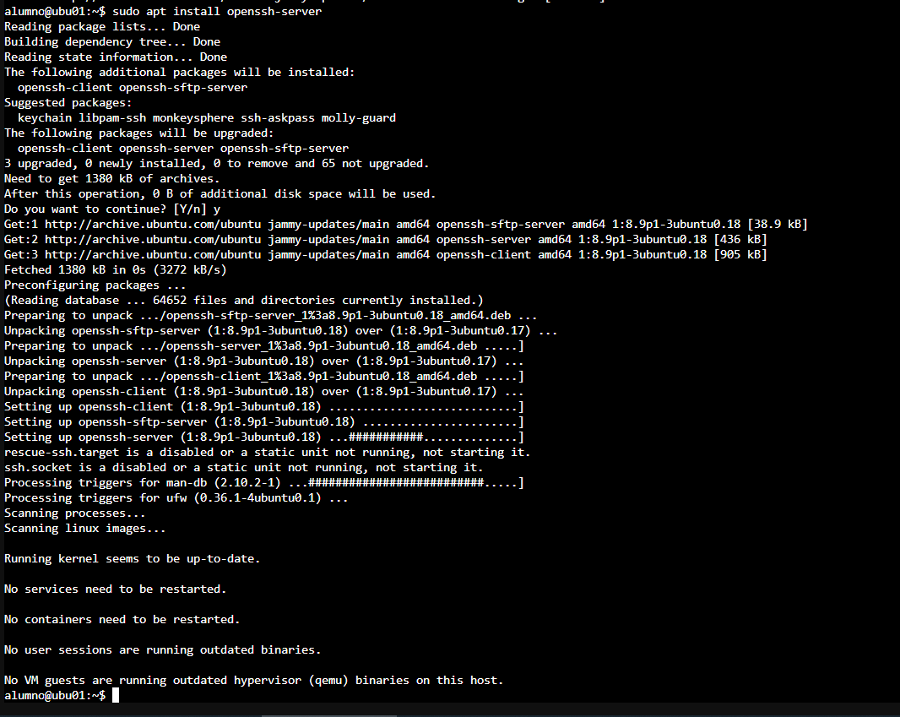
  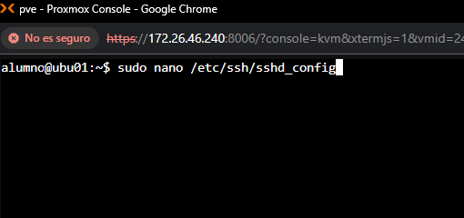
  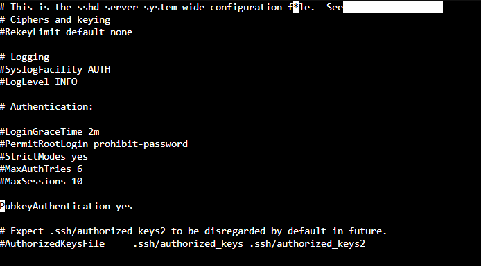
  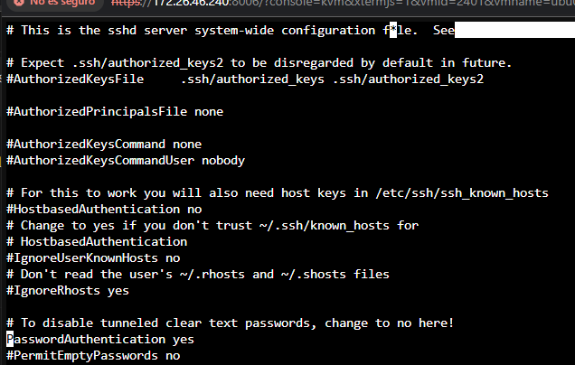
  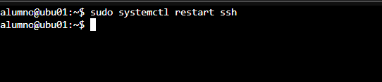
* Habilitamos el servicio SSH en pfSense desde su consola mediante la opción `14`.
  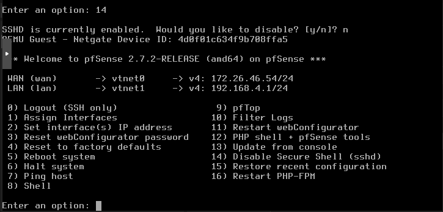
* Generamos el par de claves `ed25519` en nuestro PC Windows (`ssh-keygen -t ed25519 -f D:\ssh\id_ed25519`) sin frase de paso.
  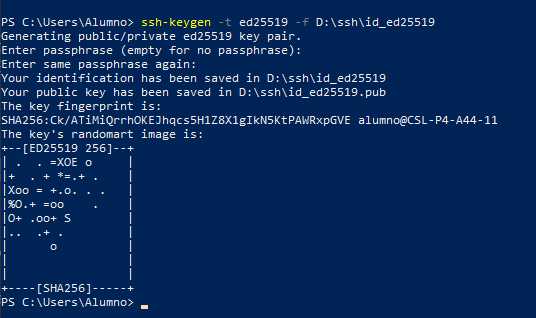
* Accedemos a la interfaz web de pfSense (`172.26.46.54`) y creamos en **Firewall > NAT** las redirecciones desde la red del aula (`172.26.44.0/24`) hacia cada servidor (`2241`–`2244`).
  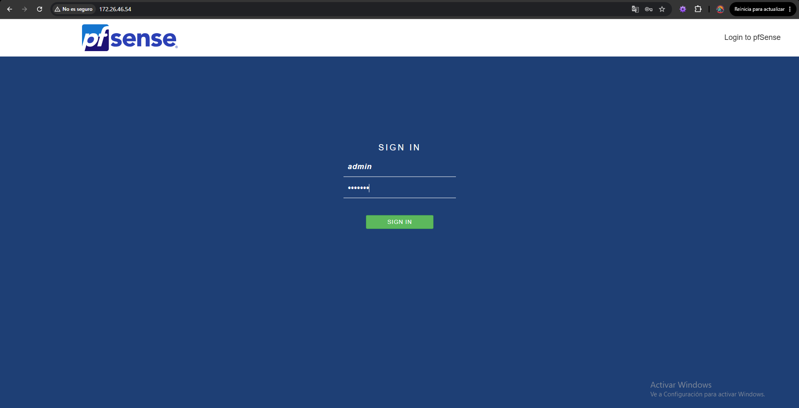
  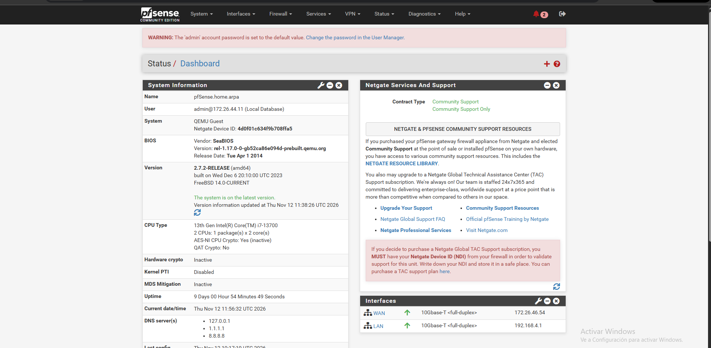
  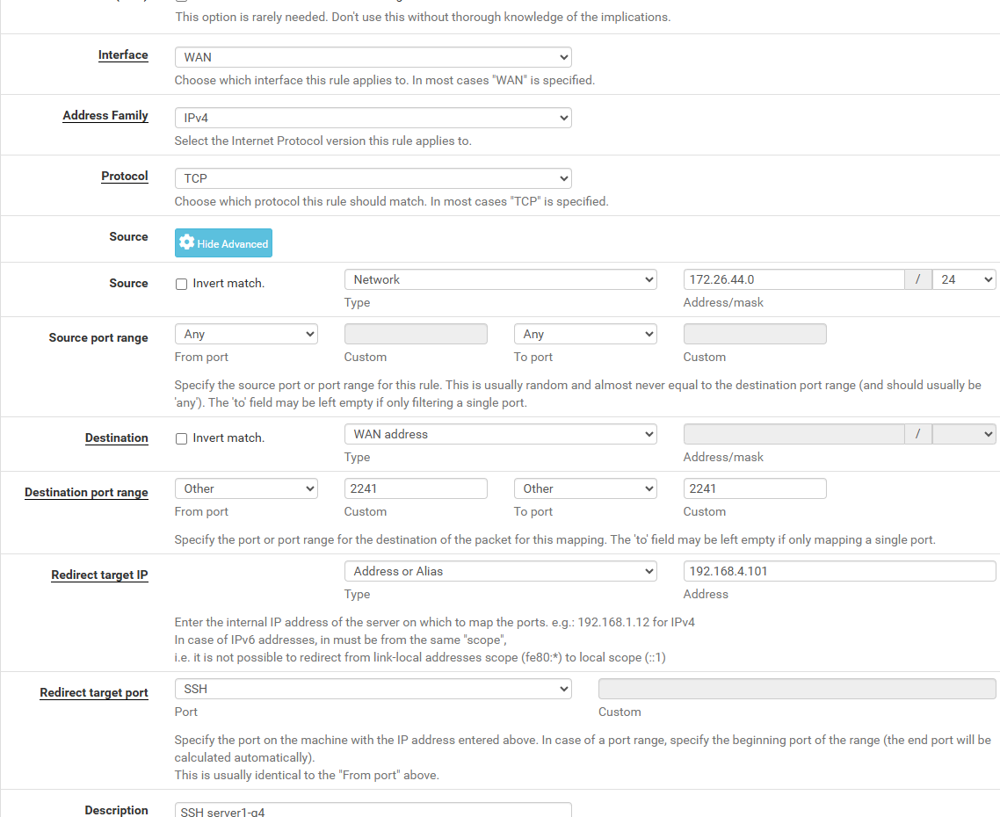
* Habilitamos `PasswordAuthentication yes` en `/etc/ssh/sshd_config.d/60-cloudimg-settings.conf` para copiar nuestra clave pública desde PowerShell y verificamos el acceso mediante clave privada (`ssh -i D:\ssh\id_ed25519 -p 2244 alumno@172.26.46.54`).
  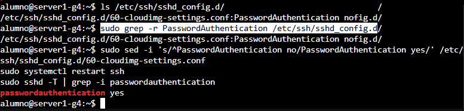
  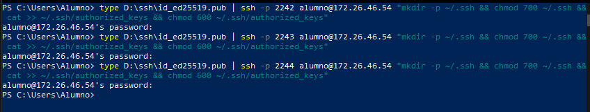
  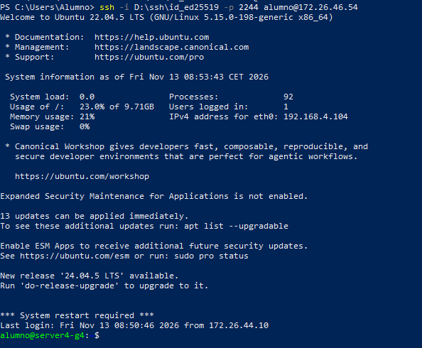

---

## Fase 1: Cortafuegos Perimetral pfSense y Reglas NAT

### 1.1. Desactivar DHCP en pfSense

* Antes de desplegar nuestros propios servidores DHCP, deshabilitamos el servicio DHCP integrado en pfSense desde **Services > DHCP Server > LAN**, desmarcando *Enable DHCP server on LAN interface* y guardando los cambios.
  

### 1.2. Creación de Reglas de Port Forwarding (NAT)

* Dado que pfSense aplica por defecto una política restrictiva que bloquea el tráfico entrante desde el exterior, creamos en **Firewall > NAT > Port Forward** las reglas necesarias restringiendo el origen a la red del aula (`172.26.44.0/24`):
  * **SSH (TCP):** Puertos `2241` -> `192.168.4.101:22`, `2242` -> `192.168.4.102:22`, `2243` -> `192.168.4.103:22` y `2244` -> `192.168.4.104:22`.
    
    
    
    
  * **Apache2 (TCP):** Puerto `8480` -> `192.168.4.103:80`.
    
  * **Monitorix (TCP):** Puerto `8481` -> `192.168.4.103:8080`.
    
  * **DNS (TCP/UDP):** Puerto `53` -> `192.168.4.101:53`.
    
* Aplicamos la configuración con **Apply Changes** y comprobamos la tabla completa de reglas NAT activas.
  
  

---

## Fase 2: Servicio DHCP en Alta Disponibilidad (Failover)

* Instalamos `isc-dhcp-server` en `server1-g4`, identificamos la interfaz `eth0` con `ip a` y la configuramos en `/etc/default/isc-dhcp-server`.
  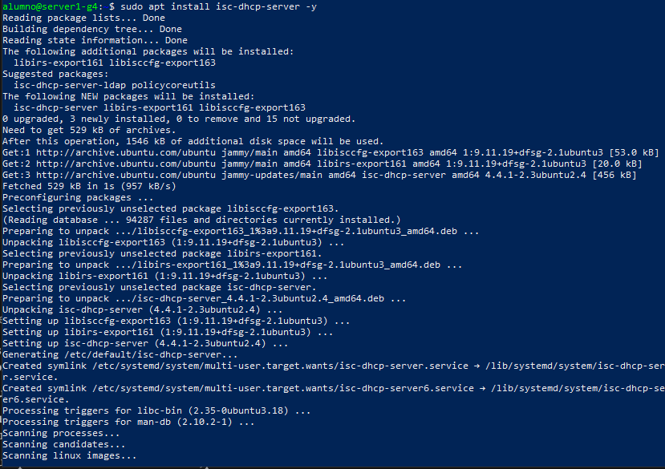
  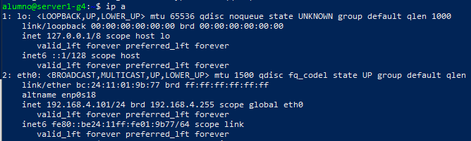
  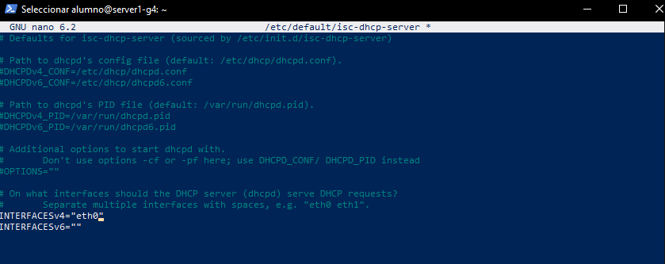
* Configuramos `/etc/dhcp/dhcpd.conf` en `server1-g4` como `primary` (`192.168.4.101`, puerto `647`), repartiendo el rango `192.168.4.150`–`192.168.4.199` y entregando el dominio `grupo4reto4.eus` junto con nuestros DNS (`.101` y `.102`). Validamos la sintaxis (`dhcpd -t`), arrancamos el servicio y comprobamos el estado `Both servers normal` en los logs.
  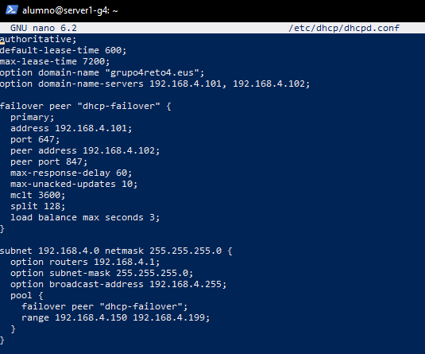
  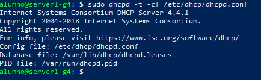
  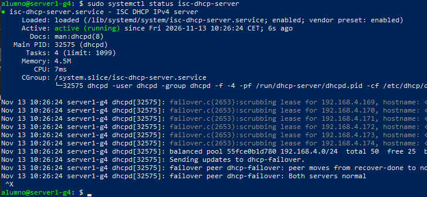
  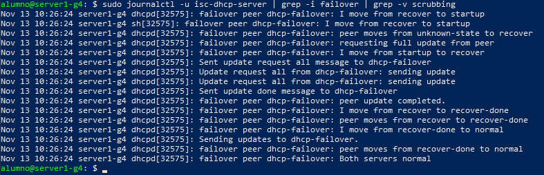
* Repetimos el despliegue en `server2-g4` como `secondary` (`192.168.4.102`, puerto `847`), validando la sintaxis y el arranque del servicio.
  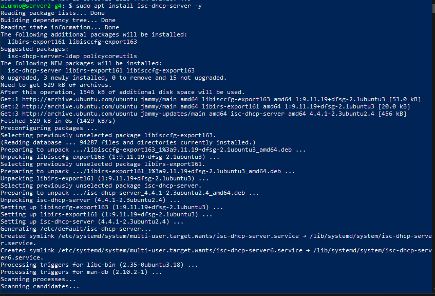
  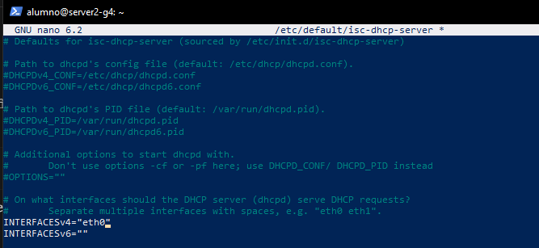
  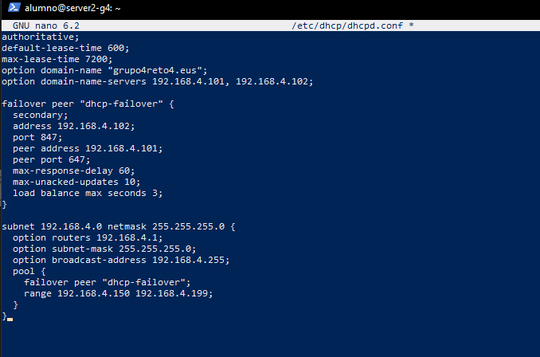
  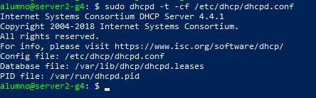
  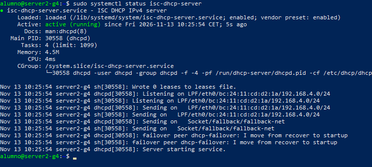
* Añadimos la reserva por dirección MAC para `server4-g4` (`192.168.4.104`) en ambos servidores, configuramos `dhcp4: true` en su Netplan y comprobamos que obtiene la IP reservada y la mantiene incluso tras detener el servicio DHCP en `server1-g4`.
  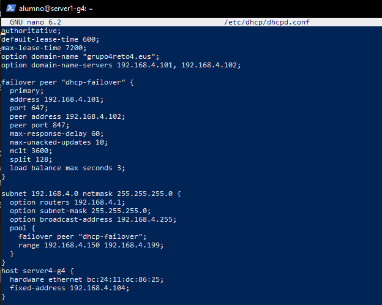
  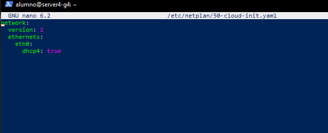
  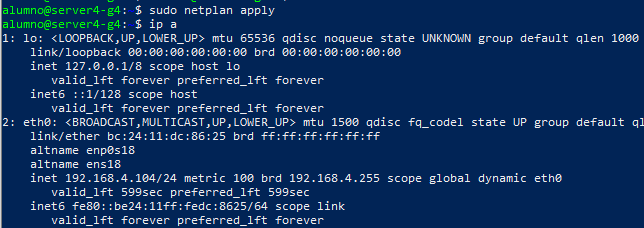
  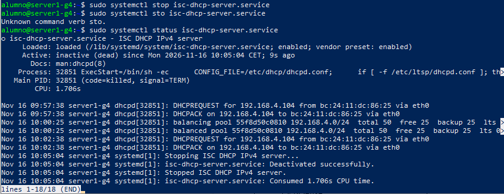
  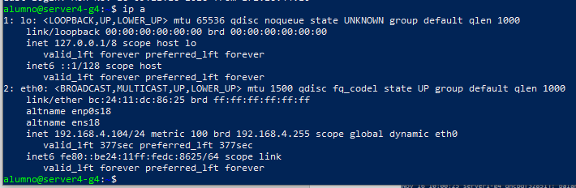

---

## Fase 3: Servicio DNS Maestro-Esclavo (`grupo4reto4.eus`)

* Instalamos `bind9`, `bind9utils` y `dnsutils` en ambos servidores DNS y configuramos `/etc/bind/named.conf.options` con los reenviadores `1.1.1.1` y `8.8.8.8`, validación DNSSEC y escucha exclusiva en IPv4.
  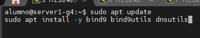
  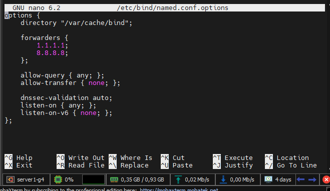
* Definimos en `/etc/bind/named.conf.local` del maestro las zonas directa (`grupo4reto4.eus`) e inversa (`4.168.192.in-addr.arpa`) autorizando la transferencia y notificación hacia `192.168.4.102`. Creamos `db.grupo4reto4.eus` (registros `A` y alias `CNAME`: `dns1`, `dns2`, `monitor`, `web-proxmox`, `cliente`, `www`) y `db.192.168.4` (registros `PTR`), validándolos con `named-checkconf` y `named-checkzone`.
  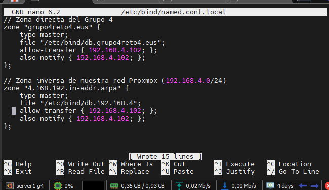
  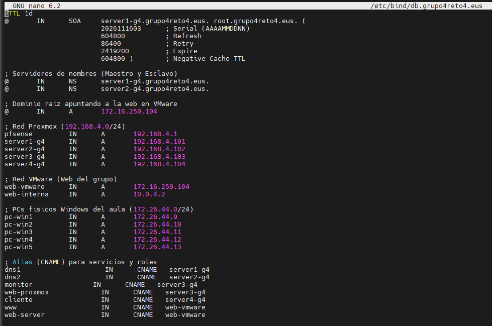
  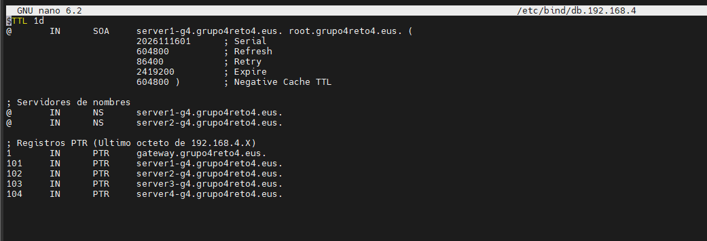
  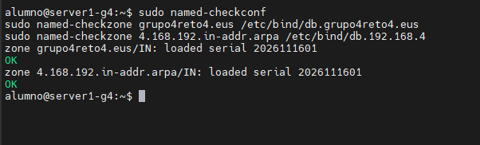
* Configuramos `server2-g4` como esclavo (`type slave`) y verificamos la transferencia automática de las zonas en `/var/cache/bind/`. Asignamos ambos DNS (`192.168.4.101` y `192.168.4.102`) y el dominio `grupo4reto4.eus` en Cloud-Init desde Proxmox.
  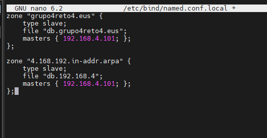
  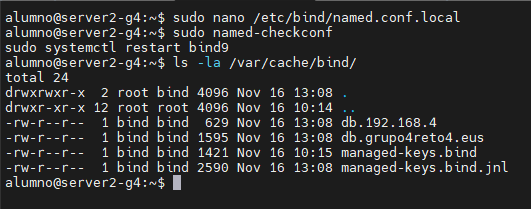
  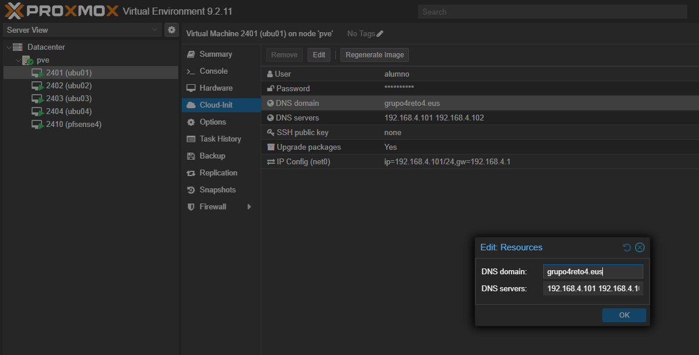
* **Pruebas de funcionamiento, sincronización y alta disponibilidad:**
  * Incrementamos el Serial en el maestro a `2026111603`, recargamos el servicio (`sudo systemctl reload bind9`) y verificamos en `server2-g4` tanto el registro `SOA` actualizado como los logs de transferencia (`Transfer status: success`).
    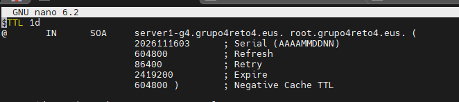
    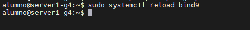
    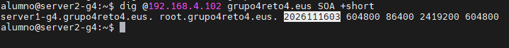
    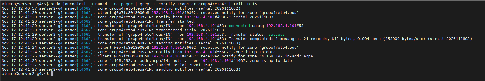
  * Comprobamos la resolución externa desde un PC Windows del aula hacia la IP WAN de pfSense (`nslookup www.grupo4reto4.eus 172.26.46.54`).
    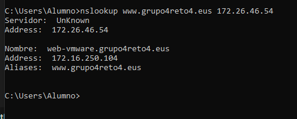
  * Verificamos resoluciones inversas (`dig -x`), directas (`pc-win3`, `monitor`) y acceso web por nombre (`curl server3-g4`) en ambos servidores, comprobando finalmente la continuidad del servicio al detener `bind9` en `server1-g4`.
    
    
    
    
    
    
    
    
    

---

## Fase 4: Servidor Web Apache2 y Monitorización con Monitorix

### 4.1. Servidor Web Apache2 (`server3-g4`)

* Instalamos `apache2`, verificamos que el servicio esté activo y creamos `/var/www/grupo4reto4/index.html`.
  
  
  
* Creamos el VirtualHost `/etc/apache2/sites-available/grupo4reto4.conf` con logs personalizados (`grupo4reto4_access.log` y `grupo4reto4_error.log`), lo activamos con `a2ensite`, deshabilitamos `000-default.conf` y validamos la configuración con `apache2ctl configtest` (`Syntax OK`) y `apache2ctl -S`.
  
  
  
  
  
* Comprobamos el acceso interno por IP (`curl http://192.168.4.103`) y por nombre (`curl http://web-proxmox.grupo4reto4.eus`), el acceso externo desde el navegador del aula (`http://172.26.46.54:8480`) y los registros de visita en `/var/log/apache2/grupo4reto4_access.log`.
  
  
  
  
  
  

### 4.2. Monitorización con Monitorix (`server3-g4`)

* Instalamos `monitorix` y `apache2-utils`, habilitamos el servicio (`sudo systemctl enable --now monitorix`) y comprobamos que responde `HTTP/1.0 200 OK` en el puerto `8080`.
  
  
  
* Activamos la gráfica de Apache (`apache = y`) dentro del bloque `<graph_enable>` en `/etc/monitorix/monitorix.conf`, reiniciamos el servicio y comprobamos el acceso tanto desde `server4-g4` (`http://192.168.4.103:8080/monitorix`) como desde el navegador del aula (`http://172.26.46.54:8481/monitorix`).
  
  
  
  
